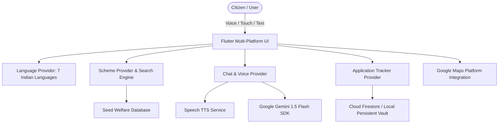

# JanSeva AI (CivicAssist) — Multilingual Voice AI for Government Schemes & Civic Services

[](https://flutter.dev)
[](https://aistudio.google.com)
[](https://firebase.google.com)
[](https://mapsplatform.google.com)

---

## 🌟 1. Problem Statement & Civic Impact

Across communities, billions in central and state welfare budgets (healthcare, agricultural subsidies, pensions, student scholarships, housing, vendor loans) go unclaimed or delayed because citizens face:
- **Language & Literacy Barriers**: Bureaucratic documentation is dense, legalistic, and rarely accessible in regional dialects.
- **Fragmented Portals**: Schemes are dispersed across dozens of municipal, state, and central websites.
- **Complex Eligibility Rules**: Citizens do not know which specific schemes apply to their unique household circumstances.
- **Physical Access Gaps**: Citizens are unaware of where their nearest Common Service Centers (Jan Seva Kendras / MeeSeva) are located.

**JanSeva AI** solves this with an intuitive, voice-first Flutter application powered by **Google Gemini**, **Cloud Firestore**, and **Google Maps Platform**.

---

## 🚀 2. Key Innovations & Features

### 🎙️ 1. Multilingual Voice-First Civic Assistant
- Citizens can **speak or type** in their native language (**Hindi, Telugu, Tamil, Marathi, Bengali, Kannada, or English**).
- Real-time animated speech wave visualizer and **Text-to-Speech (TTS)** audio playback for elderly or illiterate citizens.
- Contextual understanding of welfare queries with immediate document checklists and step-by-step guidance.

### ⚡ 2. 60-Second Citizen Eligibility Matcher
- Interactive profile parameters: Age, Gender, Occupation (Farmer, Street Vendor, Laborer, Student, Homemaker, Senior Citizen), Annual Income, State, Social Category, BPL Card status, and Landholding.
- Instant calculation of **Total Potential Annual Benefits (₹)** and matching percentage score (e.g., *95% Match*).
- Clear, bulleted explanations of fulfilled vs. missing criteria.

### 📄 3. Multimodal Document & Circular Simplifier
- Takes complex, multipage government circulars or legal notifications (e.g., PM SVANidhi credit policy, Ayushman hospital guidelines, PMAY grant orders).
- Powered by **Google Gemini**, it extracts a crystal-clear 3-point breakdown:
  1. *What this scheme/notice is about*
  2. *What financial or welfare benefit you receive*
  3. *Action steps & required documents to take to the Kendra*
- Audio read-aloud button for complete accessibility.

### 📍 4. Google Maps Seva Kendra Locator
- Dynamic radar and coordinate locator for nearby **Common Service Centers (CSCs)**, **MeeSeva Kendras**, **Municipal Ward Offices**, and **Post Office Seva Kendras**.
- Shows distance (km), opening hours, phone contact, and direct **Google Maps routing links**.

### 📋 5. My Schemes & Application Vault
- Full milestone stepper (*Saved → Docs Gathering → Submitted at Kendra → Under Verification → Approved / Disbursed*).
- Interactive document checklist allowing citizens to check off documents (Aadhaar, BPL card, Bank Passbook, Land records) as they collect them.
- Reference number tracking and persistent storage.

---

## 🛠️ 3. Architecture & Tech Stack



| Layer | Technology | Details |
|---|---|---|
| **Frontend Framework** | **Flutter 3.44+ (Dart)** | Responsive across Web, macOS Desktop, Android, and iOS |
| **Generative AI** | **Google Gemini 1.5 Flash** | Multilingual reasoning, eligibility inference, document simplification |
| **State Management** | **Provider (6.1+)** | Reactive, clean architectural separation of concerns |
| **Voice / Audio** | **flutter_tts** | Real-time multilingual voice synthesis |
| **Data Persistence** | **Cloud Firestore & SharedPreferences** | Real-time sync for applications, saved bookmarks, and user profiles |
| **Maps & Routing** | **Google Maps Platform** | Geolocation directions and service center navigation |

---

## 💻 4. How to Run Locally

### Prerequisites
- Flutter SDK (3.44+): Ensure `flutter` is in your `$PATH`.
- Google Chrome or macOS Desktop.

### Steps

```bash
# 1. Navigate to the project directory
cd CivicAI

# 2. Get dependencies
flutter pub get

# 3. Run on Chrome (Web)
flutter run -d chrome

# OR Run on macOS Desktop
flutter run -d macos

# OR Build for Web production
flutter build web --release
```

### Testing & Quality Assurance
```bash
# Run static analysis (0 errors, 0 warnings)
flutter analyze

# Run unit and widget test suite
flutter test
```

---

## 🔑 5. Configuring Google Gemini API Key

1. Obtain a free API key from [Google AI Studio](https://aistudio.google.com/app/apikey).
2. Open the app and tap the **Settings** icon (top right of the home screen).
3. Paste your API key into the **Google Gemini API** field and tap **Save Key**.
> *Note: If no API key is provided, the app automatically runs in an intelligent built-in simulation mode with pre-loaded civic reasoning responses.*

---

## 👥 Contributors & Open Civic Impact
Built for the AI Innovation Challenge to bring intelligent automation, public safety, and welfare equity to millions of underserved citizens.
